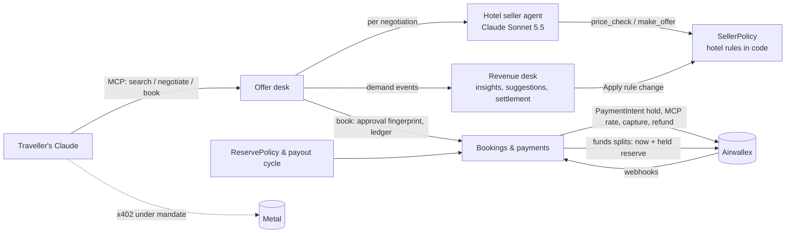

# Harbour House: a group-sales agent for hotels

Built for the Airwallex Agentic Banking Hackathon (product spec v2). A hotel's seller agent handles
group requests (RFPs) from the first email to a paid booking: it reads the inquiry, checks the hotel's
systems, asks for what is missing, quotes, negotiates in trades, books against a verified Airwallex
deposit, then handles a room reduction and the partial refund it creates. The seller is Claude
(`claude-opus-5-5`) or a deterministic rules seller with the same tools. A buyer side works only from
its own private brief.

The model negotiates and explains. Prices, authority, inventory, approvals and money movement are
enforced in code (`src/agentbank/groupsales/engine.py`), so nothing an agent writes and nothing inside
an RFP can change them. Each side sees only its own private constraints: the seller never sees the
buyer's budget mandate or deposit limits, and the buyer never sees the hotel's floors, costs or
margins. The presenter dashboard shows both sides.

Full product notes, enforced rules and the live demo script: **[GROUP_SALES.md](GROUP_SALES.md)**.
Recorded-demo shot list: [docs/DEMO_RECORDING.md](docs/DEMO_RECORDING.md).

## Run it

Offline, with no keys (simulated Airwallex twin, rules seller):

```bash
python3 -m venv .venv && .venv/bin/pip install -e '.[agent]' pytest
PAYMENTS=simulated SELLER_MODE=rules PYTHONPATH=src .venv/bin/python scripts/group_sales.py
# open http://localhost:8010, then Demo controls → Reset scenario → Yes, reset; the seller starts on its own
```

With the Airwallex sandbox and the Claude seller, copy `.env.example` to `.env` and fill in
`AWX_CLIENT_ID`, `AWX_API_KEY` (sandbox, Payment Acceptance read/write) and `ANTHROPIC_API_KEY`.
Example group-sales settings (no secrets):

```bash
PAYMENTS=simulated              # or airwallex (default when sandbox keys are set)
SELLER_MODE=rules               # or claude (default when an Anthropic key is set)
BUYER_MODE=presenter            # or agent: the buyer side replies on its own
PUBLIC_BASE_URL=http://localhost:8010   # return URL after hosted checkout
GS_PORT=8010
GS_VAR=var/groupsales           # state directory (DATABASE_URL switches to Postgres)
GS_ACCESS_TOKEN=change-me       # optional: dashboard and API need <url>/?k=<token> once
AWX_WEBHOOK_SECRET=             # optional: accept signed webhooks at POST /webhooks/airwallex
```

`/pay/…`, `/webhooks/…` and `/healthz` stay open when `GS_ACCESS_TOKEN` is set; the payment page
checks the deal's own buyer token and webhooks check their signature.

## Hotel data and buyer mandates

Everything the scenario needs is in [`data/groupsales/scenario.json`](data/groupsales/scenario.json):

| Key | What it holds |
|---|---|
| `hotel` | Harbour House, London: stay 10–13 March 2027, 14 twin and 16 king rooms free, the Thames Room (classroom for 32, 11 March), breakfast £15 (60 group covers a day) |
| `rms` | Rates per room type (twin £220 target, £210 seller floor, £195 absolute minimum; king £190 / £180 / £170), delivery costs, 40% minimum contribution margin |
| `policy` | Deposit (30% standard, up to 40%, 20–29% with the manager), attrition (10%, up to 20% with the manager), installments, cancellation, 24-hour quotes and holds, £500 seller refund limit |
| `crm` | What the hotel knows about each sender |
| `inbox` | The two RFPs: Northstar Analytics (12 twins, meeting room, £10,000 budget) and Summit Robotics (8 kings) |
| `buyers` | Each buyer's private mandate: budget, deposit limit (£ and %), objectives (e.g. Northstar wants 20% attrition), known answers, and Northstar's later change request |

Expected figures (tested): Northstar £9,600 with a 40% deposit of £3,840 and a 7 room-night
allowance, margin 67.4% / 67.2%; after the two-room reduction £8,280, revised deposit £3,312, refund
£528, £3,312 net received, £4,968 still due (£828 by 8 Feb, £4,140 by 3 Mar). Summit £4,920, deposit
£1,476.

## Checks

```bash
PYTHONPATH=src python -m pytest tests/test_group_sales.py -q    # group sales: no network, no keys
PYTHONPATH=src python -m pytest tests -q                        # whole repository
```

`tests/test_group_sales.py` covers the spec's figures and the full demo story, privacy in both
directions, authority (stale and wrong approvers, low deposits, below-floor rates, the margin floor,
instructions inside an RFP), inventory and hold expiry, payment and refund recovery, webhooks and the
access gate. The list is in [GROUP_SALES.md](GROUP_SALES.md#checks).

## What was verified live

Only what [GROUP_SALES.md](GROUP_SALES.md#verified-live-airwallex-sandbox-2026-11-02) records: one full
run on the Airwallex sandbox with the rules seller (deposit and partial refund), and one run of the
Claude seller on simulated payments. Later changes were tested offline only.

---

# Earlier project: Hotel Negotiation Desk

The rest of this README describes the earlier hackathon build on this repository (individual stays
negotiated with a traveller's Claude over MCP). It is kept for reference; it is not the group-sales
product above.

**Hotels sell rooms to AI agents, and they negotiate.** A traveller asks their Claude for a stay. Claude
talks to each hotel's own seller agent, which builds a personalised offer (breakfast, late checkout,
cancellation terms, deposit) inside the hotel's rules. The traveller approves the exact terms and pays the
deposit through Airwallex. The hotel is paid out through Airwallex Payments for Platforms, minus our
commission and a risk reserve. Every negotiation also tells the hotel what demand it is losing and why,
and the revenue desk turns that into rule changes it can apply in one click.

The **financial decisions** sit in code, and the models only negotiate and explain:

| Decision | Who decides | New information that changes it |
|---|---|---|
| Can the hotel commit to this price and these terms? | `SellerPolicy`: floors per night, occupancy, deposit vs cancellation risk, autonomy band | Rooms sell through another channel → booking returns `terms_changed` and the traveller re-approves |
| How much of the hotel's share to hold back? | `ReservePolicy`: new hotel 20%, established 5%, at least 2× its failed-stay rate | The hotel overbooks a night → guests refunded, share clawed back, reserves frozen, rate raised |
| When to pay the hotel? | Payout cycle: reserves of delivered stays only | An incident at the hotel → its reserves stay held |
| Should the hotel change its prices? | `RuleBook` suggestions from lost-deal evidence; a person clicks Apply | Each lost deal below the floor, each request for a busy night |

### Try it

- **In Claude** (claude.ai, Desktop, or Claude Code), add the connector `https://hotel-negotiation.onrender.com/mcp/<token>` (ask us for the token) and say:
  *"Find me a hotel in Paris for 2 people, 13–15 Nov 2026, with breakfast, late checkout and free cancellation, around EUR 500. Negotiate, then book by card with the deposit in GBP."*
  A live panel shows both agents negotiating. Pay the hold with test card `4035 5010 0000 0008`.
- **As the hotel**: the revenue desk at `/dashboard/<admin token>` shows demand, lost deals, suggestions, settlement and reserves, and runs check-out, the payout cycle and the sandbox simulations.
- **As a new hotel**: sign up at `/join/<join token>` (linked from the revenue desk). The hotel is bookable by buyer agents as soon as it submits; its Airwallex connected account is opened in the background and card payouts start once it accepts cards.
- **The 3-minute demo script** is in [DEMO.md](DEMO.md).

### Airwallex, Metal and Claude in it

| Product | What we use it for | Where |
|---|---|---|
| Payments: PaymentIntents | Deposit as a pre-auth hold (Airwallex.js drop-in), released on free cancellation, captured late or on no-show, raised with `increment_authorization` and captured at check-out; refunds when a hotel can't deliver | `bookings.py`, `web/hotel_pay.html` |
| Multi-Currency Pricing | Deposit held in the guest's currency (USD/GBP) at a rate locked at booking; the hotel prices and is paid in EUR | `guest_currency.py` |
| Payments for Platforms | Hotels sign themselves up and are onboarded as connected accounts by API (store details, card capabilities); each capture split to the hotel as funds splits, one released and one held as a reserve; reserves released by the payout cycle or reversed when a stay isn't delivered | `hotel_onboarding.py`, `bookings.py`, `reserves.py` |
| Webhooks | HMAC-verified, deduped `payment_intent.*` events refresh bookings and live panels | `webhooks.py` |
| Metal (testnet) | The traveller's agent pays the deposit over x402 under an on-chain mandate capped at the budget (local demo) | `metal/hotel-pay.ts`, `scripts/metal_*` |
| Claude | Hotel seller agents (Sonnet 5.5, prompt caching, effort medium) with typed tools; MCP server and MCP App panel for the traveller's Claude | `seller_agent.py`, `scripts/hotel_mcp.py`, `ui/` |

### How it follows the guide

| Guide rule | Here |
|---|---|
| Keep amounts, limits, reserves, validation and state in code | `SellerPolicy`, `ReservePolicy`, the payout cycle and the booking state machine are code; the seller agent can only commit what `make_offer` lets through |
| Typed tools, not credentials | The seller has `get_inventory`, `price_check`, `make_offer`; the traveller's Claude has six MCP tools; no keys reach a model |
| Bind each approval to amount, counterparty, terms and evidence | Booking takes only an `offer_id`; its approval fingerprint covers hotel, room, dates, extras, cancellation, deposit and total; changed terms need a new yes |
| One request_id per operation; a non-success is ambiguous | `ledger.py` (at most once per business key); payout retries list existing splits first; payment retries use a new key only after a definite failure |
| Keep customer funds separate | Each traveller's session is its own tenant; each hotel is paid only its own share, reconciled per hotel |
| Sandbox-only simulations behind one interface | `simulation.py`, `market_simulation.py` |
| Webhooks: HMAC on raw bytes, dedupe on event id, return 200 fast | `webhooks.py` |
| Show what the agent did and why | Live negotiation panel (never the floors), audit log, demand log, dashboard |

### Architecture



### Verified

- Live in the sandbox: pre-auth holds confirmed with the test card, cancelled and captured; a EUR deposit and a GBP deposit (Multi-Currency Pricing) captured and split to the hotel's connected account (EUR 457.60 and GBP 397.06, both RELEASED); hotels onboarded with card capabilities by API.
- Reserves and incidents, live: a EUR 520 check-out split EUR 366.08 to the hotel now and EUR 91.52 as a held reserve, which the payout cycle then released; a non-refundable EUR 300 stay at a hotel that overbooked was refunded in full and the hotel's EUR 211.20 + 52.80 splits reversed; both hotels' ledgers reconciled.
- Self-serve onboarding, live (2026-10-27): a hotel signed up on the join page was listed immediately, found by a buyer agent over MCP in a Barcelona search and negotiated by its own seller agent (EUR 574 published, EUR 450 committed with breakfast, late checkout and free cancellation) while Airwallex onboarded it; its connected account reached ACTIVE with card capabilities 2.5 minutes later. The five newer seed hotels were onboarded the same way.
- Hosted on Render and used by friends from claude.ai through the MCP connector.
- Seller agent eval (`scripts/eval_seller.py`): 12 scenarios across 7 hotels in two cities (boutique, business, budget and luxury), including prompt injection, a fake "manager", competing quotes, hard haggling and impossible budgets, graded in code for outcome, no leaks, every quoted price backed by a committed offer, and staying in budget. Latest full run on Sonnet 5.5 (2026-10-27): 23/24 conversations passed every check; the one miss was a grader false positive (the seller offered more flexible cancellation than asked), since fixed and that scenario re-run clean 3/3. About $0.03 per conversation.
- 113 offline tests (plus 7 against Postgres) (`python -m unittest discover tests`), including ambiguous payouts never sent twice, reserves and the payout cycle, overbooking refunds and clawbacks, changed terms at booking, rule suggestions, tenant isolation, webhook signatures and hotel sign-ups (validation, listing, onboarding, retries, restarts).

### Details

Hotels run their own seller agents (Claude, `seller_agent.py`) that negotiate personalised offers
with the traveller's Claude, within per-hotel rules in `data/hotels.json`. `SellerPolicy`
(`offers.py`) decides in code what a seller may commit to. Deposits are paid by card through
Airwallex (pre-auth hold, released on free cancellation, captured late or at check-out) or by the
traveller's agent on Metal, under an on-chain mandate capped at the budget (`bookings.py`).

```sh
pip install -e ".[agent]"                         # anthropic + mcp
scripts/metal_traveller_setup.sh 0.50             # once: traveller's Metal account + mandate (budget in *USDZ)
claude mcp add hotels -- $PWD/.venv/bin/python $PWD/scripts/hotel_mcp.py    # search, negotiate, book
claude mcp add metal-wallet -- $PWD/scripts/metal_wallet_mcp.sh              # pay within the mandate
(cd metal && npx tsx hotel-pay.ts)                # keep running: x402 endpoint for Metal deposits
```

Then ask Claude for a Paris hotel, 2 guests, 13-15 Nov 2026, breakfast + late checkout + free
cancellation, EUR 500 total. Card checkouts open on `http://127.0.0.1:8009/pay/<ref>` (test card
`4035 5010 0000 0008`). Hotel staff: `python scripts/hotel_ops.py list` and
`python scripts/hotel_ops.py <ref> status|cancel|check-out|no-show`.

**Live negotiation room (MCP App).** In Claude Desktop and claude.ai, `search_hotels` opens a panel in
the chat that follows every round live: both agents' messages, the hotel agent's steps as it works
(never its floors), offers with Book buttons (they post the choice into the chat, so Claude still
confirms terms) and bookings as deposits are held or paid. Source in `ui/`; after editing,
`cd ui && npm install && npm run build` regenerates `web/negotiation_app.html`. `node test/run.mjs`
renders it in a test host with `test/feed.json` (regenerate with `.venv/bin/python ui/test/make_feed.py`)
and screenshots both themes into `ui/test/out/`. Terminal clients get the same rounds as text.

**Sharing with friends (Render).** `render.yaml` deploys the same server over HTTP: Render >
New > Blueprint > this repo, then fill in `ANTHROPIC_API_KEY`, `AWX_CLIENT_ID`, `AWX_API_KEY`.
The MCP URL is `https://<service>.onrender.com/mcp/<HOTELS_ACCESS_TOKEN>` (the token is generated;
find it under the service's Environment). Friends add it in Claude (Settings > Connectors > Add custom
connector) or ChatGPT (developer mode connectors). Each chat session gets its own negotiations, offers,
bookings and panel; hotel inventory is shared. Hosted is card-only, capped per session and per day
(`HOTELS_MAX_*`, `HOTELS_DAILY_USD`). Try it locally first:
`HOTELS_ACCESS_TOKEN=<16+ chars> PORT=8765 python scripts/hotel_mcp.py --http`.

**Keeping state on a free host (Postgres).** Render's free instances lose their disk on every deploy and
every idle spin-down. With `DATABASE_URL` set (`pip install -e ".[agent,postgres]"`), `storage.py` keeps
bookings, the operation ledger, the demand, audit and webhook logs, rule changes and hotel sign-ups in
Postgres instead of `var/`. Supabase's free tier works: use the **transaction pooler** URL (the direct
`db.<project>.supabase.co` host is IPv6-only, which Render can't reach). Tables live in the `agentbank`
schema, outside what Supabase's REST API exposes, and rows are namespaced (`STORAGE_NAMESPACE`: `hosted` on
Render, `local` elsewhere), so a laptop with the same URL never touches the hosted data. Each store loads once
and writes through, which assumes a single instance. Negotiations still open in memory are lost on restart;
everything booked or logged is not. Postgres tests: `TEST_DATABASE_URL=... python -m unittest tests.test_storage`.

**Evaluating the seller agent.** `python scripts/eval_seller.py [--runs 3] [--only name,...]` plays
scripted buyers against the real seller agent from fresh inventory and grades each conversation in
code: the expected outcome (closes a feasible deal, declines honestly, holds the line), no leaks of
floors, costs or occupancy, every quoted price backed by a committed offer, and deals within budget.
About $0.03 per conversation on Sonnet 5.5 (the default; `SELLER_MODEL` to change); transcripts go to `var/evals/`.

Offline: `python scripts/negotiation_demo.py` (scripted negotiation, no LLM) and
`python scripts/payments_smoke.py card|metal` (booking and payment, no LLM).

**Guest currency (card).** `book_offer(..., currency="USD"|"GBP")` holds the deposit in the guest's
currency while prices, floors and offers stay in EUR (`guest_currency.py`). It uses Airwallex
Multi-Currency Pricing: a 24-hour conversion quote is applied to the fresh PaymentIntent, which then reads
in GBP/USD (`original_amount` keeps the EUR). The booking's `fx` stores the rate and both amounts;
late-cancellation captures and the check-out increment use that locked rate, rounded half-to-even. If
Airwallex can't quote, the deposit stays in EUR and `fx.error` says why. `payments_smoke.py card GBP` tries it.
Verified in the sandbox on 2026-10-23 (EUR 300 -> GBP 260.31 / USD 348.09). Caveats: Airwallex guarantees
the settled amount only if captured within 12 hours, so a capture weeks later may settle at a newer rate.
The sandbox refuses a conversion quote on an intent tagged with a connected account ("not allowed ... for
platform payments"), so guest-currency intents are left untagged and still split to the hotel after capture.

**Hotel payouts (Airwallex connected accounts).** The platform owns each card payment ("collect payments
directly") and tags it with the hotel's connected account; after every capture (late cancellation,
no-show, check-out, non-refundable charge) a FundsSplit sends the hotel its share and the commission
(`platform.commission_pct` in `data/hotels.json`, 12%) stays with the platform. The booking's
`settlement` records both, in EUR and, for guest-currency bookings, in the card's currency. A failed split
leaves the capture standing; `hotel_ops.py <ref> settle` retries it. `scripts/onboard_hotels.py` onboards
each hotel. Sandbox lessons (2026-10-23): an ACTIVE connected account still fails PaymentIntents with
"not enabled for payment acceptance" until it has `store_details` (store names in unaccented Latin
letters) and the `payments_visa`/`payments_mastercard` capabilities are enabled, a few seconds after
activation; a FundsSplit is only accepted once the intent has SUCCEEDED. Verified live: EUR 520 tagged
intent split EUR 457.60 to the hotel, and an untagged GBP 451.20 intent split GBP 397.06 (both RELEASED).

**Hotels sign themselves up (Merchant Onboarding).** `/join` (locally `http://127.0.0.1:8009/join`; hosted
`<service URL>/join/<HOTELS_JOIN_TOKEN>`, linked from the revenue desk) takes the hotel's name, city, contact, a selling
style (boutique, business, budget, luxury), room types with published and lowest rates, extras and a note for its
agent. `hotel_onboarding.py` validates it in code (lowest rate at most the published rate and at least 40% of it,
whole euros, at most 4 room types); the style sets the risk rules (deposit minimums, cancellation premiums, autonomy
band), so a form can't give a seller terms the platform wouldn't stand behind. The hotel is listed at once: buyer
agents find it with `search_hotels(city=...)` and its seller agent negotiates from the next call. In the background
the Accounts API creates its connected account (store details, card capabilities), the sandbox simulates
verification, and once it accepts cards its captured deposits split to it like any other hotel's; until then cards
are collected without a payout split. Progress shows on the sign-up page and in the revenue desk's *Hotels on the
marketplace* (with Retry if Airwallex refused). Sign-ups persist in `var/hotels_onboarded.json` (or Postgres, below). In production the
hotel would complete KYC in Airwallex's embedded onboarding component or hosted flow instead of synthetic details.

**Revenue desk (hotel dashboard).** The offer desk logs every search, negotiation, policy check, committed
offer and booking to `var/demand.jsonl` (hotel side: it holds floors). The dashboard shows the funnel,
how much of the floor-to-list band deals kept, unmet demand and why it was lost (below the floor with the
gap, sold out, offer not taken), demand by night and by extra, and payouts. Locally:
`http://127.0.0.1:8009/dashboard` (or `python scripts/hotel_ops.py insights`); hosted:
`<service URL>/dashboard/<HOTELS_ADMIN_TOKEN>` (generated by render.yaml; off when unset).

The dashboard also acts. **Suggested rule changes** (`rule_tuning.py`) turn its evidence into one concrete
change each: a lower floor on the nights where at least two travellers walked away below it (capped at 15%
a night, with how many of those deals it would have closed), a 15% higher rate on busy nights that keep
being asked for, or a wider autonomy band when deals close near the floor. **Apply** edits the hotel's live
rules (per-night overrides in `Hotel.night_floors` / `night_rates`), so seller agents price with them from
their next step; applied changes persist in `var/rule_changes.json`, can be reverted, and show conversion
before and after. **Booking actions** (refresh, check-out, no-show, cancel) run the same payment flows as
`hotel_ops.py`, so a check-out from the dashboard captures and pays the hotel out. Buttons that move money
or change rules ask for a second click.

- Metal amounts use a demo rate of 0.001 *USDZ per EUR (faucet amounts are small).
- Metal testnet needs `@metalntwx/*` 0.3.2; 0.3.0's account factory call reverts.
- A mandate's budget never resets: after test payments, bind a fresh one with `metal-agent mandate renew`.
- Metal refunds for free cancellations are recorded as due, not sent.

**Reserves, the payout cycle and incidents (Kit 8).** Each hotel's share goes out as two funds splits:
one released at once and a reserve held (`auto_release: false`) at a rate `ReservePolicy`
(`reserves.py`) sets in code from that hotel's own record: 20% while it has delivered fewer than five
stays, 5% after, and never less than twice its failed-stay rate (capped at 50%). Every retry first lists
the payment's splits, so an ambiguous split is never sent twice. The payout cycle (dashboard button)
releases reserves of delivered stays, except at a hotel with an incident in the last 30 days. An incident
(a hotel can't honour a night) releases affected guests' holds or refunds them in full, claws the
hotel's share back by funds split reversal (reserve first), freezes its reserves and raises its rate.
The dashboard reconciles each hotel: owed = paid + held + clawed back.

**Changed terms at booking (Kit 10).** Booking re-checks the hotel's policy. If rooms sold through
another channel or the offer expired, `book_offer` returns `terms_changed` with the closest offer the
hotel can commit (whole euros, other room types if needed) and nothing is charged until the traveller
approves it. The live panel shows the new offer with its Book button.

**Webhooks.** With `AWX_WEBHOOK_SECRET` set, `POST /webhooks/airwallex` checks the HMAC-SHA256 of
`x-timestamp` + raw body (5-minute window), dedupes on event id, answers at once, then re-reads the
PaymentIntent from the API and moves the booking from that (`webhooks.py`). Register the URL in the
Airwallex web app (Settings > Developer > Webhooks) for `payment_intent.*` events.

**Sandbox simulations** (`market_simulation.py`, one interface as the guide asks): rooms sold through
another channel, and a hotel overbooking a night. Both are on the dashboard.


### Foundation: agentbank (kit-agnostic starter)

A kit-agnostic foundation for any of the ten starter kits. It implements the guide's
"build around a financial decision" rules so your team only writes the decision logic:

| Guide rule | Where it lives |
|---|---|
| Keep amounts, limits, reserves and validation in code | `policy.py`, `money.py` (Decimal, never floats) |
| Duplicate protection; reuse a `request_id` only to retry the same operation | `ledger.py` |
| Treat non-success on money movement as ambiguous; look up before retrying | `airwallex/client.py` → `AmbiguousResult` |
| Bind each approval to amount, currency, counterparty, terms and evidence | `approvals.py` (fingerprinted, single-use, expiring) |
| Put sandbox-only simulation calls behind one interface | `simulation.py` |
| Give the model typed tools, not credentials | `agent/tools.py` (strict schemas) |
| Show what the agent did and why | `audit.py` → `var/audit.jsonl` |

#### Setup

```sh
python3.13 -m venv .venv && source .venv/bin/activate   # Python 3.10+ (macOS system python3 is 3.9)
pip install -e ".[agent]"
cp .env.example .env                                  # bare values: no quotes or spaces
python scripts/check_setup.py                         # login, Global Accounts, balances
```

Other scripts (run from the repo root):

| Script | Does |
|---|---|
| `scripts/fund_sandbox.py 25000 USD` | Simulates a deposit into a Global Account in that currency, creating one only if needed |
| `scripts/seed_beneficiaries.py` | Creates US (LOCAL), GB (LOCAL) and DE (SWIFT) synthetic suppliers from `data/beneficiaries.json` |
| `scripts/run_agent.py <beneficiary_id>` | Example treasury agent: three invoices, scarce cash above a reserve floor, approvals in the console |

Tests (offline, no network): `python -m unittest discover tests`

#### Layout

```
src/agentbank/
  config.py           .env loading; rejects quoted or padded credentials (the HTML-403 trap)
  money.py            Money(amount: Decimal, currency) in major units
  airwallex/
    client.py         auth + token cache, retries (GET on 5xx/429; POST only on 429), x-on-behalf-of
    api.py            thin wrappers: balances, Global Accounts, FX, beneficiaries, transfers,
                      issuing, payments/disputes, connected-account transfers, charges
    states.py         normalised transfer and card-transaction outcomes
    errors.py         AirwallexError (definite) vs AmbiguousResult (unknown outcome)
  simulation.py       deposits, transfer transitions, card authorizations, disputes
  ledger.py           one request_id per business operation, at-most-once execution
  approvals.py        ApprovalRequest fingerprinting, ApprovalStore, ConsoleApprover
  policy.py           PaymentPolicy example: reserve floor, autonomous limit, confidence, SWIFT fee
  audit.py            append-only JSONL with secrets redacted
  agent/
    tools.py          tool schemas + handlers (policy -> approval -> ledger -> API)
    loop.py           manual tool-use loop on claude-opus-5-5, refusal fallbacks on
```

#### Adapting it to your kit

1. **Write the policy first** (`policy.py`). The decision your demo turns on (reserve
   floor, forecast confidence, dispute economics, tenant isolation) belongs in code that
   returns `EXECUTE`, `NEEDS_APPROVAL` or `REJECT`, with reasons.
2. **Add tools** in `agent/tools.py`, copying `pay_beneficiary`: validate input, then policy,
   then approval if needed, then `ledger.run(key, call)`, then audit. Read-only tools can skip the ledger.
3. **Pick ledger keys from business identity**, not attempts: `transfer:INV-1001`,
   `fx:payroll-2026-w43:EUR`. A deliberate replacement after a bounced transfer is a
   *new* operation, so give it a new key (e.g. `transfer:INV-1001:replacement-1`).
4. **Drive the scenario's "new information" through `simulation.py`** (a late deposit,
   a transfer moved to FAILED, a declined authorization) and let the agent re-plan.

#### Sandbox behaviour verified on 2026-10-19

These came from running kits 1–3 against a real sandbox account. Some contradict the guide.

- **Declined card transactions also have `transaction_type: CLEARING`.** Use
  `states.card_outcome()`, which decides on `status`/`failure_reason`.
- **A failed transfer reads back as `CANCELLED`** with `failure: {code, message, details.type}`.
  The simulator recorded `INCORRECT_ROUTING` when asked for `BENEFICIARY_BANK_RETURNED`, so
  key decisions on what Airwallex returns, not on what you simulated.
- **Deposits post within a few seconds, not always instantly.** Re-read balances before re-planning.
- **Kit 4 card payments:** confirming a PaymentIntent with raw card details returns
  *"account is not enabled for native API access"*. Ask devhelp@airwallex.com to enable it,
  or pay through the hosted payment page / a payment link with test card `4035501000000008`.
- Per-transaction card limits are inclusive ($100.00 clears on a $100 limit; $100.01 fails).
- FX conversions settle immediately; quotes are single-use; leave `x-api-version` off FX calls.
- Sandbox rate limits: 10 req/s per endpoint. The client backs off on 429; don't fire parallel bursts in a demo.

