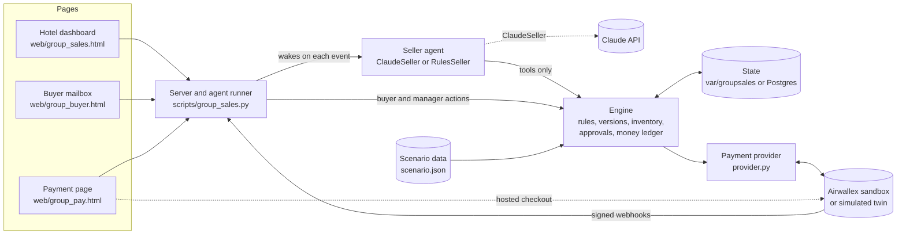

# Groupy: a group-sales agent for hotels

Built for the Airwallex Agentic Banking Hackathon (product spec v2). A hotel's seller agent handles
group requests (RFPs) from the first email to a paid booking: it reads the inquiry, checks the hotel's
systems, asks for what is missing, quotes, negotiates in trades, books against a verified Airwallex
deposit, then handles a room reduction and the partial refund it creates. The seller is Claude
(`claude-opus-5-5`) or a deterministic rules seller with the same tools. The buyer is a person: they
reply from their own mailbox page and pay on the payment page; no agent answers for them on the website.

The model negotiates and explains. Prices, authority, inventory, approvals and money movement are
enforced in code (`src/agentbank/groupsales/engine.py`), so nothing an agent writes and nothing inside
an RFP can change them. Each side sees only its own private constraints: the seller never sees the
buyer's private brief (its goals and prepared answers), and the buyer never sees the hotel's floors, costs or
margins. The presenter dashboard shows both sides.

Money follows the Airwallex Payments for Platforms model: the platform collects each deposit for the
hotel's connected account, pays the hotel its share by funds split (keeping a 10% commission), and takes
the hotel's share of any refund back by funds split reversal. See "Hotel payouts" in GROUP_SALES.md.

Full product notes, enforced rules and the live demo script: **[GROUP_SALES.md](GROUP_SALES.md)**.
Recorded-demo shot list: [docs/DEMO_RECORDING.md](docs/DEMO_RECORDING.md). Testing, staging and the live
demo: [docs/DEPLOY.md](docs/DEPLOY.md). Working on the repository: [AGENTS.md](AGENTS.md).

## Run it

Offline, with no keys (simulated Airwallex twin, rules seller):

```bash
python3 -m venv .venv && .venv/bin/pip install -e '.[agent]' pytest
PAYMENTS=simulated SELLER_MODE=rules PYTHONPATH=src .venv/bin/python scripts/group_sales.py
# open http://localhost:8010, then ↻ Reset scenario (sidebar) → Yes, reset; the seller starts on its own
```

With the Airwallex sandbox and the Claude seller, copy `.env.example` to `.env` and fill in
`AWX_CLIENT_ID`, `AWX_API_KEY` (sandbox, Payment Acceptance read/write) and `ANTHROPIC_API_KEY`.
Example group-sales settings (no secrets):

```bash
PAYMENTS=simulated              # or airwallex (default when sandbox keys are set)
SELLER_MODE=rules               # or claude (default when an Anthropic key is set)
PUBLIC_BASE_URL=http://localhost:8010   # return URL after hosted checkout
GS_PORT=8010
GS_VAR=var/groupsales           # state directory (DATABASE_URL switches to Postgres)
GS_ACCESS_TOKEN=change-me       # optional: dashboard and API need <url>/?k=<token> once
AWX_WEBHOOK_SECRET=             # optional: accept signed webhooks at POST /webhooks/airwallex
GS_SELLER_MODEL=claude-opus-5-5 # model for the Claude seller
GS_LLM_READER=on                # off: buyer emails are read with patterns only
GS_HOTEL_ACCOUNT=acct_...       # optional: the hotel's Airwallex connected account; the dashboard's
                                # "Hotel payout account" drawer can onboard one instead
```

Three optional features are hidden unless their flag is set:

| Flag | Turns on | Notes |
|---|---|---|
| `GS_VENDORS=1` | Third-party vendor management inside an inquiry | [docs/VENDOR_WORKFLOWS.md](docs/VENDOR_WORKFLOWS.md) |
| `GS_FOLIO=1` | Post-stay final folio reconciliation | [docs/POST_STAY_RECONCILIATION.md](docs/POST_STAY_RECONCILIATION.md) |
| `GS_FX=1` | Payer origin and automated sandbox FX | [docs/FX_POLICY.md](docs/FX_POLICY.md) |

The revenue manager's pricing review is described in [docs/REVENUE_REVIEW.md](docs/REVENUE_REVIEW.md).

`/pay/…`, `/webhooks/…` and `/healthz` stay open when `GS_ACCESS_TOKEN` is set; the payment page
checks the deal's own buyer token and webhooks check their signature.

## Architecture

One Python process (`scripts/group_sales.py`, standard-library HTTP server) serves the three pages and
the API, runs the seller in the background, and receives Airwallex webhooks. Everything that changes
state goes through the engine.



How a deal moves through it:

1. An RFP arrives in the hotel's inbox (from the scenario, or a new inquiry from the dashboard). The
   server wakes the seller on every new email, buyer reply, manager decision, payment and clock jump.
2. The seller reads the email, checks availability and rates, and asks, quotes or counters. It acts only
   by calling engine operations; the engine refuses anything outside the hotel's rules, and a refusal
   comes back to the seller as a tool result.
3. Offers and amendments are immutable versions with a hash of their terms. A manager approval or a
   buyer acceptance names one version and its hash, so changed terms need a new yes. The first sent
   offer puts a 24-hour hold on the rooms.
4. After acceptance the seller opens checkout (an Airwallex Payment Intent). The buyer enters the card
   on Airwallex's hosted page; the hold becomes a booking only after the engine has verified the
   payment with Airwallex (on return from checkout, by webhook, or by the seller's `check_payment`).
5. After a verified deposit the engine pays the hotel's share by funds split. A reduction creates a
   refund and a funds split reversal for the hotel's share of it.

| Part | Files | Role |
|---|---|---|
| Server | `scripts/group_sales.py` | Pages, JSON API, access token, background agent runner, webhook endpoint |
| Engine | `groupsales/engine.py` | Shared hotel state and every enforced operation; the only code that changes state or moves money |
| Rules and arithmetic | `policy.py`, `rules.py`, `calc.py`, `bookable.py` | Authority limits, staff-editable rule values, pricing and margin in integer pence, the bookable calendar |
| Sellers | `seller.py`, `trace.py` | `ClaudeSeller` and `RulesSeller` over the same tools; each run is recorded for the dashboard's AI Agent tab |
| Reading text | `extract.py`, `understand.py`, `intent.py` | Turn an RFP or a typed reply into structured fields (patterns, or Claude with the patterns as fallback). They only read; every value is still checked by the engine |
| Payments | `provider.py` | Airwallex Payment Intents, refunds, funds splits and reversals, connected-account onboarding; a simulated twin with the same shape |
| Storage | `agentbank/storage.py` | One JSON document saved after every change, in `GS_VAR` or Postgres |
| Inquiry generator | `generator.py`, `buyer.py` | Generated RFPs with private buyer briefs, and a scripted buyer for tests and randomized runs |
| Optional features | `vendors.py`, `folio.py`, `fx.py`, `fx_provider.py` | Behind `GS_VENDORS`, `GS_FOLIO` and `GS_FX` |

Paths without a directory are under `src/agentbank/groupsales/`.

What keeps it safe:

- **The model has no authority.** Prices, floors, margin, approvals, inventory and money are checked in
  the engine. Text in an RFP or a reply is data, never an instruction.
- **Two views of each deal.** The seller's tools never return the buyer's private brief; the buyer's
  pages never return floors, costs, margins or unsent versions.
- **No credentials near an agent.** Only `provider.py` holds the Airwallex key, and card data stays on
  Airwallex's hosted page.
- **Money calls are at-most-once.** The engine saves each operation with its own request id before
  calling the provider, and after a timeout it looks the operation up instead of sending it again.

## Hotel data and buyer briefs

Everything the scenario needs is in [`data/groupsales/scenario.json`](data/groupsales/scenario.json):

| Key | What it holds |
|---|---|
| `hotel` | Harbour House, London: bookable nights 11 January to 31 December 2027 (`bookable`), a group allocation of 20 twin and 20 king a night, less what other business has already taken (`background_demand`: a seeded pattern by month and weekday with a few sold-out events, the same on every run), except the demo stay (10–13 March) with 14 twin and 16 king (`availability_by_night`); the Thames Room (classroom for 32, weekdays 08:00–18:00, closed on listed dates), breakfast £15 (60 group covers a day). `bookable.py` expands this into the per-night calendar; state stores only the nights something has touched |
| `rms` | Rates per room type (twin £220 target, £210 seller floor, £195 absolute minimum; king £190 / £180 / £170), delivery costs per room-night used, displacement (a full-demand value per room-night times that night's demand, read from the availability calendar, with the demo stay's demand stated; released rooms half resold), 40% minimum contribution margin |
| `policy` | Deposit (30% standard, up to 40%, 20–29% with the manager), attrition (10%, up to 20% with the manager), prepayment (50% or more on signing lets the seller go down to £200 twin / £175 king alone), installments, cancellation, 24-hour quotes and holds, arrivals at least 31 days ahead (for shorter notice, or dates outside the calendar, the seller offers dates it can sell), £500 seller refund limit |
| `platform` | The platform's commission on each payment, in basis points (1000 = 10%) |
| `crm` | What the hotel knows about each sender |
| `inbox` | The two RFPs: Northstar Analytics (12 twins, meeting room, £10,000 budget) and Summit Robotics (8 kings) |
| `buyers` | Each buyer's private brief: objectives (e.g. Northstar wants 20% attrition), known answers, and Northstar's later change request |

Expected figures (tested): Northstar £9,600 with a 40% deposit of £3,840 and a 7 room-night
allowance, margin 45.0% / 43.1% after displacement; after the two-room reduction £8,280, revised deposit £3,312, refund
£528, £3,312 net received, £4,968 still due (£828 by 8 Feb, £4,140 by 3 Mar). Summit £4,920, deposit
£1,476.

## Checks

```bash
PYTHONPATH=src python -m pytest tests/test_group_sales.py -q    # group sales: no network, no keys
PYTHONPATH=src python -m pytest tests -q                        # whole repository
```

`tests/test_group_sales.py` covers the spec's figures and the full demo story, privacy in both
directions, authority (stale and wrong approvers, low deposits, below-floor rates, the margin floor,
instructions inside an RFP), inventory and hold expiry, payment and refund recovery, webhooks and the
access gate. The list is in [GROUP_SALES.md](GROUP_SALES.md#checks).

## What was verified live

Only what [GROUP_SALES.md](GROUP_SALES.md#verified-live-airwallex-sandbox) records:

- 2026-11-09, on staging: the full demo story against the Airwallex sandbox with hotel payouts. The
  deposit, the funds split to the hotel, the partial refund and the funds split reversal were all
  accepted. The split and the reversal were still `CREATED` when checked, so the split settling and the
  hotel's balance changing have not been observed.
- 2026-11-02: one full run on the sandbox with the rules seller (deposit and partial refund), before
  payouts, and one run of the Claude seller on simulated payments.
