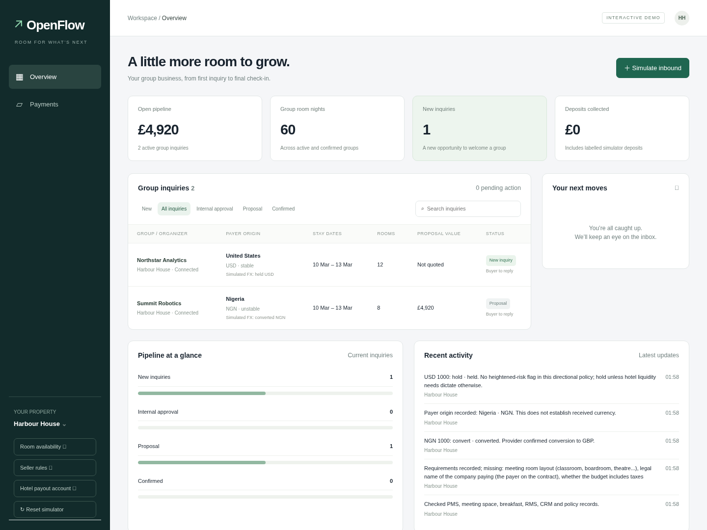
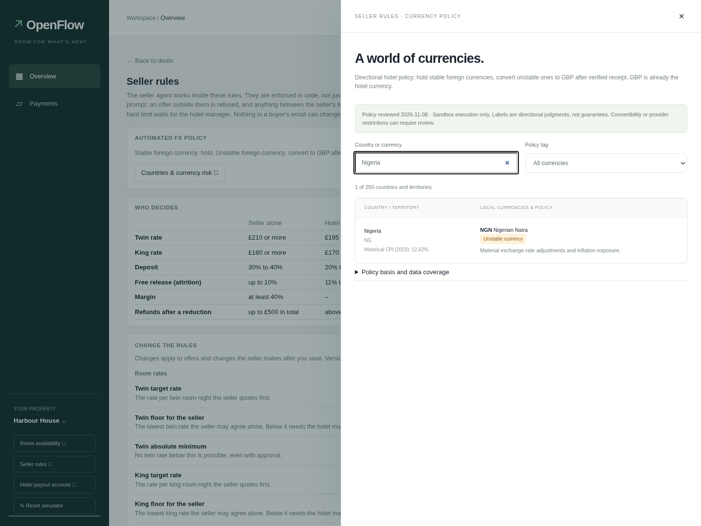
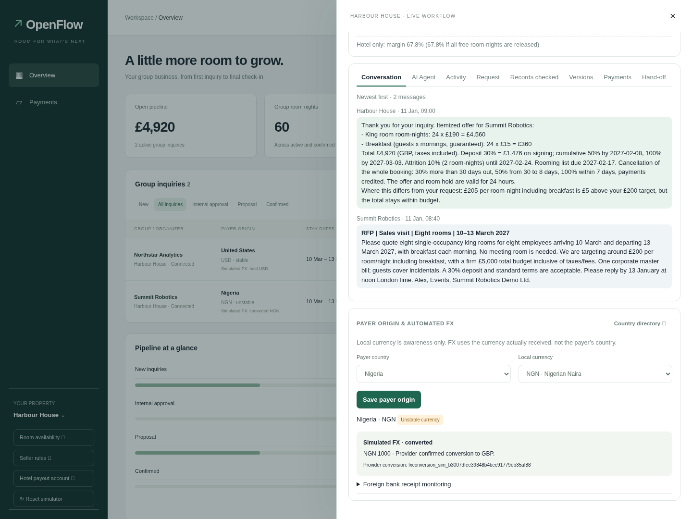

# Payer origin and automated sandbox FX

The pipeline now shows payer country, local currency, the directional risk label,
and the latest verified FX outcome. Country/currency is awareness metadata; it is
not evidence that a payment was received in that currency. Existing inquiries
start as **Not recorded**, without guessing from email domains or names.

Hotel staff record origin in the inquiry drawer. Authenticated intake integrations
can also supply `payer_country` (ISO alpha-2) and optional `payer_currency` to
`POST /api/inbox`. Countries with multiple listed currencies require an explicit
choice. Unknown or no-tender countries are left for review.

## The country directory

Seller rules → **Countries & currency risk** opens a searchable directory of all
249 ISO 3166-1 countries/territories plus Kosovo (XK). Multiple currencies are
listed separately; Antarctica and other entries without recorded legal tender
are not assigned an invented currency. The same currency has the same tag across
countries: USD in Zimbabwe is tagged like USD in the United States.

The country/tender data is bundled from pinned pycountry ISO and Unicode CLDR
sources. `scripts/build_fx_catalog.py` reproduces it. World Bank CPI context is
bundled from a pinned public mirror; its latest year is **2023**, not current
macroeconomic data. Every observation is dated in the directory.

`data/groupsales/fx_policy.json` contains the directional hotel policy requested
for this prototype. Heightened-risk flags consider persistent inflation,
devaluation, monetary-regime changes, capital controls, liquidity and material
FX swings. These are policy judgments, not an external rating or a guaranteed
forecast. Other known currencies use a stable baseline. The rationale and review
date are visible. No claim is made that this is a live macro-data model.

Policy reviewed: 8 November 2026. After 180 days it returns **Review needed** for
foreign currencies rather than automatically acting on stale classifications.
Changing the watchlist or refreshing its date requires a reviewed code change;
RFP text and seller prompts cannot alter it. Unknown currencies also require
review. A country's own historical inflation does not automatically downgrade a
shared or foreign currency used there.

## What the agent actually does

- Stable foreign currency: **hold**.
- Flagged/unstable foreign currency: seek a firm quote and **convert the verified
  received amount to GBP**, using the hotel's sandbox wallet.
- GBP: **hold, already in hotel currency**.
- Missing/expired classification, insufficient available balance, unavailable FX
  pair or provider restriction: **review**, without claiming conversion.

Current Harbour card checkout charges GBP. Its existing amount/currency checks,
immutable offers, deposits, payouts and refunds are unchanged. A US or Nigerian
payer paying that checkout produces a verified **GBP hold**, not a USD/NGN
conversion. The FX journal records this as soon as the payment is verified.

Foreign-currency execution applies to **separate bank-transfer treasury receipts**
in the hotel's sandbox Global Accounts. Every inquiry gets a unique reference
that is visible under **Foreign bank receipt monitoring**. The background worker
checks every 30 seconds, scoped to the hotel's connected account, and matches
settled provider credit/deposit transactions by that exact reference. Origin can
remain unknown: actual verified currency determines the action. A manual
**Check receipts now** performs the same scoped scan.

These bank funds do **not** confirm a booking, pay a GBP invoice, create a second
card receipt, or enter Harbour's booking/payout ledger. A proper bank-payment
booking/reconciliation flow would be a separate feature. This boundary avoids
loosening the existing card-deposit and payout contracts.

The adapter uses `/global_accounts`, their `/transactions`, `/balances/current`,
`/fx/quotes/create`, `/fx/conversions/create`, and conversion lookups. It refuses
any API base other than `https://api.sandbox.airwallex.com/api/v1`. Every call
uses the hotel's connected-account scope; platform wallet funds are not used.
Provider-supported currencies, Global Account capability and FX permissions are
prerequisites. Unfamiliar provider transaction shapes or unsettled/non-credit
records cannot authorize a conversion. Real provider payloads and permissions
still need verification on Render staging.

### Durable execution

`groupsales_fx_journal.json` uses the repository's normal file/Postgres document
storage, outside scenario state. It persists receipt identity and a deterministic
request ID before money movement, and persists the quote before submission.
Timeouts and unrecognized outcomes become **unknown**; later scans look up the
existing conversion instead of submitting again. A conversion is labelled
complete only after a matching provider response confirms currencies, amount,
request ID and completed status. Existing receipt identities cannot be rebound
to another deal or amount. Run-scoped views prevent old outcomes appearing on
new inquiries after reset, while retained receipt IDs prevent repeat conversion.

No endpoint accepts a browser's claim that foreign money was received. The
browser can only record origin, request a scoped scan, or (when payments are
simulated) create an explicitly labelled local fixture.

## Local demonstration and checks

With simulated payments, save a payer origin and use **Simulate 1,000
local-currency receipt** in that inquiry's monitoring section. USD demonstrates
hold; NGN demonstrates conversion. The fixed simulated rate is illustrative and
is not a market quote. No money moves and no booking is confirmed. This fixture
endpoint is refused when using the real Airwallex provider.

```bash
PYTHONPATH=src .venv/bin/python -m pytest tests -q
node --check web/fx.js
node --test tests/test_openflow_demo.cjs

# Isolated test server; do not use a real database or hosted dashboard.
DATABASE_URL= PAYMENTS=simulated SELLER_MODE=rules GS_PORT=8014 \
  GS_VAR=/tmp/harbour-fx-test .venv/bin/python scripts/group_sales.py
# In a second terminal with Playwright available:
NODE_PATH=/path/to/playwright/node_modules node ui/test/fx.cjs
```

`FX_TEST_URL` can choose another **loopback** port; the FX browser test refuses a
remote host. It resets only that local test scenario. It checks the directory,
multi-currency/no-tender cases, focus, payer metadata, USD hold, NGN conversion,
duplicate protection, booking separation, search, persistence and mobile layout.

The Python tests also cover GBP receipts from high-risk origins, unknown origin,
access gates, receipt mismatches, quote/balance failures, unknown currencies,
policy expiry, sandbox-only execution, account scope, timeout recovery and reset
isolation. The original spec amounts remain unchanged.

The older `scripts/e2e_demo.js` currently waits for the hidden `#queue .q` legacy
layout and times out on the workbench already present on main. This check was
attempted and is recorded as failed, not passed. The current workbench browser
suite (`ui/test/openflow.cjs`) passes; its before-screenshot readiness selector now
supports either the original or workbench layout.

## Render staging verification

No Render or GitHub settings were changed and no deploy was triggered. Per
[AGENTS.md](../AGENTS.md), a person needs to deploy the branch to Render staging
for an Airwallex sandbox check; the keys' IP whitelist excludes this development
environment. Verify the connected hotel's Global Account capabilities, credit
transaction field mapping, exact-reference matching, supported FX pair, firm
quote, one conversion and lookup recovery. Never use production credentials.
A successful local simulation is not evidence that those live API calls work.

## Screenshots





[Mobile directory](screenshots/fx/mobile-directory.png).
