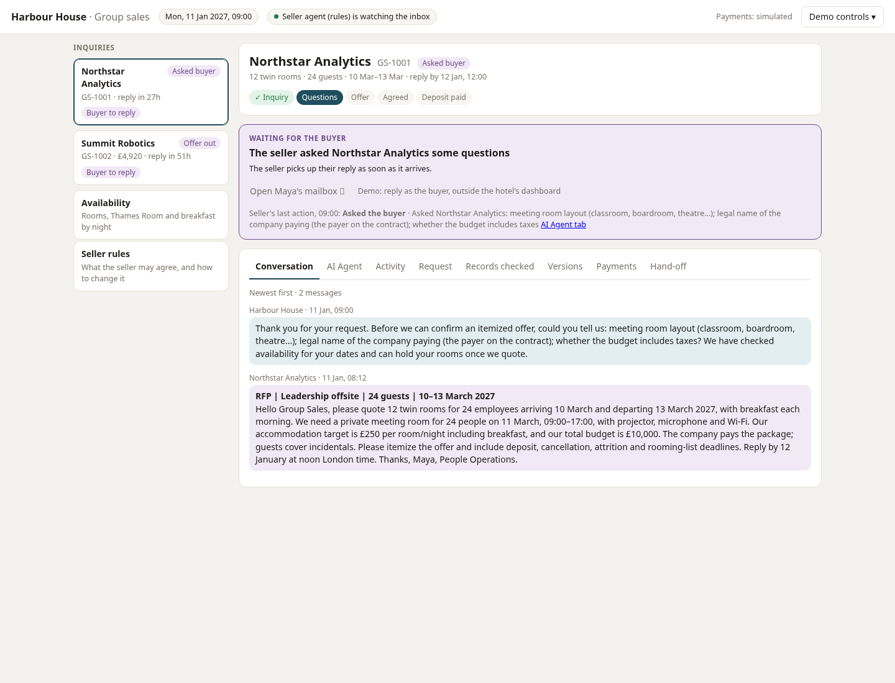
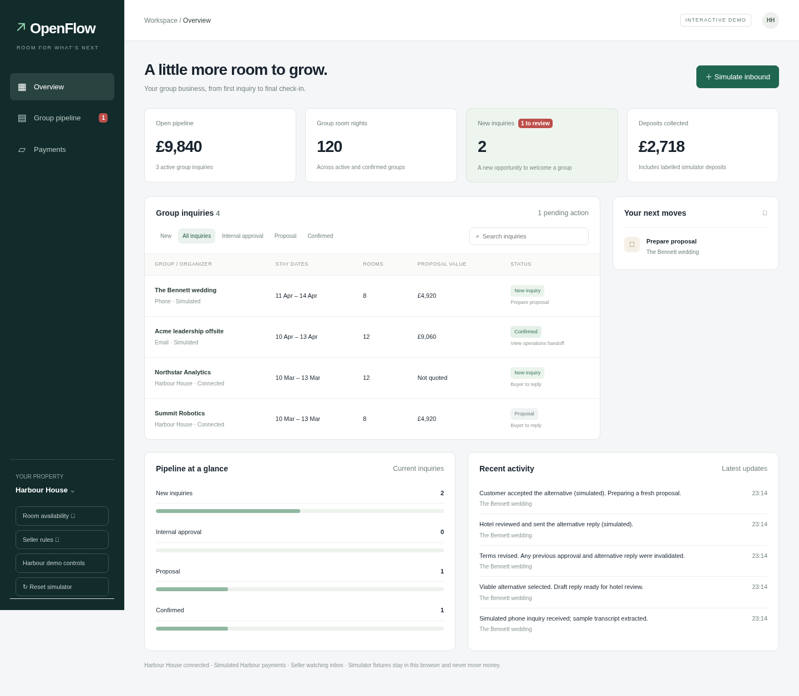
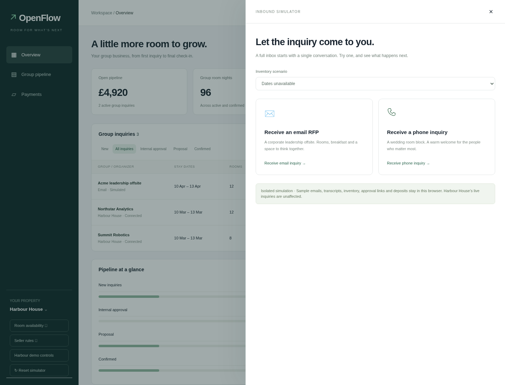
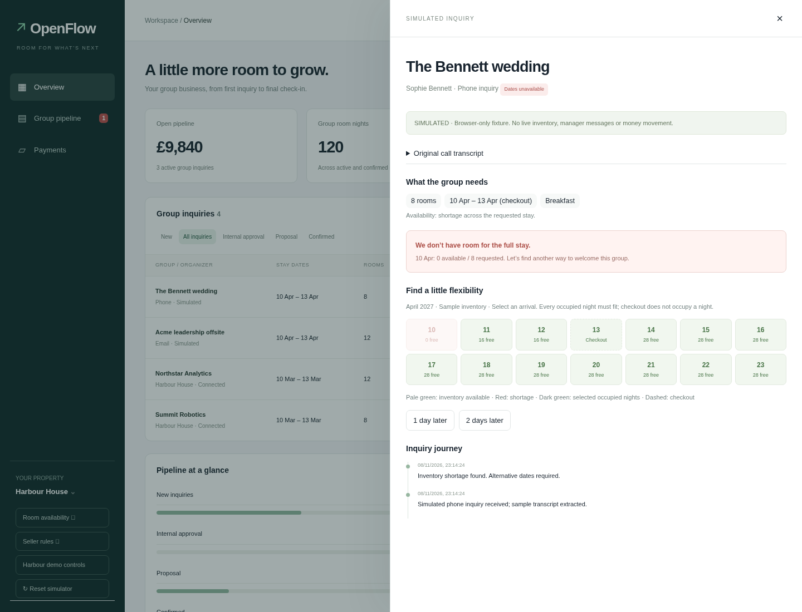
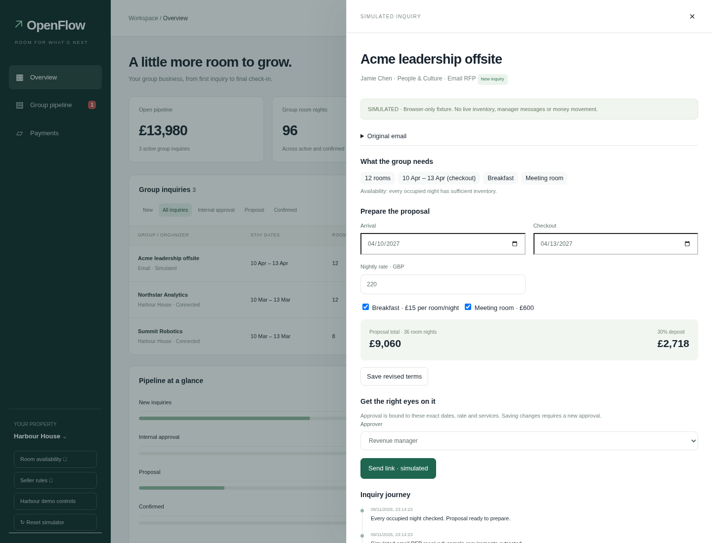

# OpenFlow group sales workbench

The group-sales server now presents an OpenFlow-style overview, pipeline and
payments view. It uses the existing Python HTTP server and plain HTML/CSS/JS;
there is no new production dependency or frontend build step.

## Connected Harbour workflows

The existing `/api/state` supplies live inquiries, finance, inventory, approvals,
and activity. Connected rows open Harbour's existing inquiry controls in a right
side drawer, including conversation, versions, manager approvals, payment checks,
refund recovery and operations handoff. Buyer mailboxes still open separately.
Availability, seller rules, the original RFP intake and Harbour demo controls are
under the property tools. On mobile, expand **Property tools** in the sidebar.
The dashboard cookie gate and backend authority, inventory, immutable offer
versions, payment verification and webhook contracts are unchanged. The three new
static assets use explicit authenticated routes, not a directory-serving route.

## Isolated reference demo

**Simulate inbound** creates labelled browser-only fixtures. These are stored
under `openflow-harbour-demo-v1` in localStorage. Reset simulator removes only
these fixtures; Harbour's own scenario reset remains in Harbour demo controls.
Simulator interactions never send a POST to a Harbour API or contact a payment
provider. They are suitable for demonstrating the reference UX, not for making
real bookings or authorizing real transactions.

Harbour's real scenario supports 10–13 March 2027. The simulator uses its own
April 2027 inventory so it can show alternative dates without changing that
backend contract. Email and phone samples are deterministic corporate-offsite and
wedding fixtures, with sample requirements and original text. They do not claim
to parse arbitrary emails or transcribe real calls. Random inventory chooses
available or unavailable with equal probability; deterministic options exercise
both paths. Full-stay validation excludes checkout and subtracts other confirmed
simulator groups. No viable stay can be confirmed without a current exact-terms
approval. Dates, rate or service changes invalidate approval. Deposits are always
30%, labelled simulated, and recorded once on confirmation.

Approval links are simulated deliveries and work only in the browser that holds
the fixture. They expose a manager review view, not a remotely authenticated
manager role. No manager email or operations message is actually delivered.
Simulator pricing and service choices are demonstrative, independent of Harbour's
RMS and real policy. Real inquiries continue to use Harbour's policy engine.

## Summary definitions

- Open pipeline: latest proposal totals of active connected inquiries plus active
  simulator drafts/proposals. Unquoted inquiries contribute zero value.
- Group room nights: active and confirmed blocks, excluding declined/expired live
  inquiries. Each occupied room-night counts once.
- New inquiries: connected inquiries in intake/needs-info and simulator drafts or
  alternative-date review. The adjacent review badge counts items needing hotel
  action; an inquiry waiting for buyer details can be new without needing action.
- Deposits collected: connected net receipts plus simulated deposits. The Payments
  view identifies each source and distinguishes browser fixtures from Harbour's
  simulated provider and Airwallex sandbox.

## Validation

From the repository root:

```bash
python3 -m venv .venv
.venv/bin/pip install -e '.[agent]' pytest
PYTHONPATH=src .venv/bin/python -m pytest tests -q
node --test tests/test_openflow_demo.cjs
node --check web/openflow.js
node --check web/openflow-demo.js
```

The GitHub **Group sales** workflow runs these offline checks on pull requests
and pushes to main. Postgres tests require `TEST_DATABASE_URL`; otherwise they
are explicitly skipped. The unrelated legacy MCP UI bundle is not changed.

For browser checks, install Playwright in a temporary directory rather than
changing the legacy UI dependencies, and install its Chromium if needed:

```bash
npm install --prefix /tmp/openflow-browser playwright
/tmp/openflow-browser/node_modules/.bin/playwright install chromium
PAYMENTS=simulated SELLER_MODE=rules BUYER_MODE=presenter \
  GS_PORT=8011 GS_VAR=/tmp/openflow-harbour-test \
  .venv/bin/python scripts/group_sales.py
# In another terminal, from the same repository root:
NODE_PATH=/tmp/openflow-browser/node_modules node ui/test/openflow.cjs
```

Use an isolated server with no `DATABASE_URL` and no access token for this test;
never point it at a deployed dashboard. The default target is port 8011;
`OPENFLOW_TEST_URL` overrides it. `CHROMIUM_PATH` can select a system browser;
otherwise the test uses `/usr/bin/chromium` if present, then Playwright's browser.

The browser test exercises connected detail/rules, both deterministic simulator
paths, changed-terms reapproval, decline reasons, customer acceptance, deposits,
handoff, filters, search through polling, payment-source labels, local persistence,
manager links, drawer keyboard focus and mobile layout. It also verifies that
simulator actions make no API writes. Screenshots are saved below; the before
image is rendered from `origin/main` on the same isolated backend.

## Screenshots and reference limits

The reference URL was blocked by the development environment's network policy,
and no reference images were available in this chat. This implementation follows
the supplied brief's colors, dimensions, copy and interaction requirements; it has
not been visually compared against the hosted reference. It deliberately keeps
Harbour's richer connected inquiry controls rather than replacing them with demo
controls. Outbound Opportunities and the hosting site's Edit site control are
omitted.

| Before | OpenFlow overview |
| --- | --- |
|  |  |





Mobile: [overview](screenshots/openflow/mobile.png) ·
[simulator](screenshots/openflow/mobile-simulator.png).
