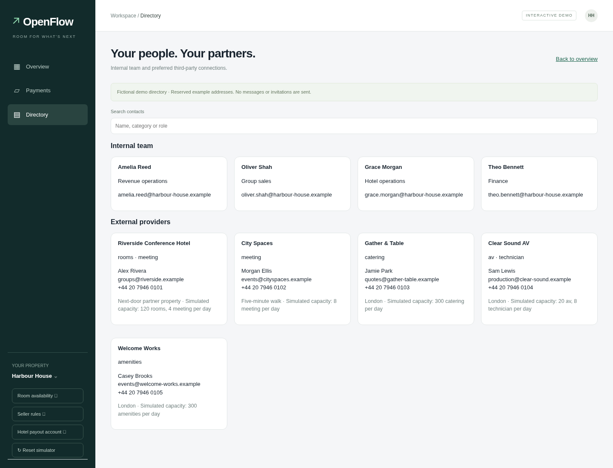
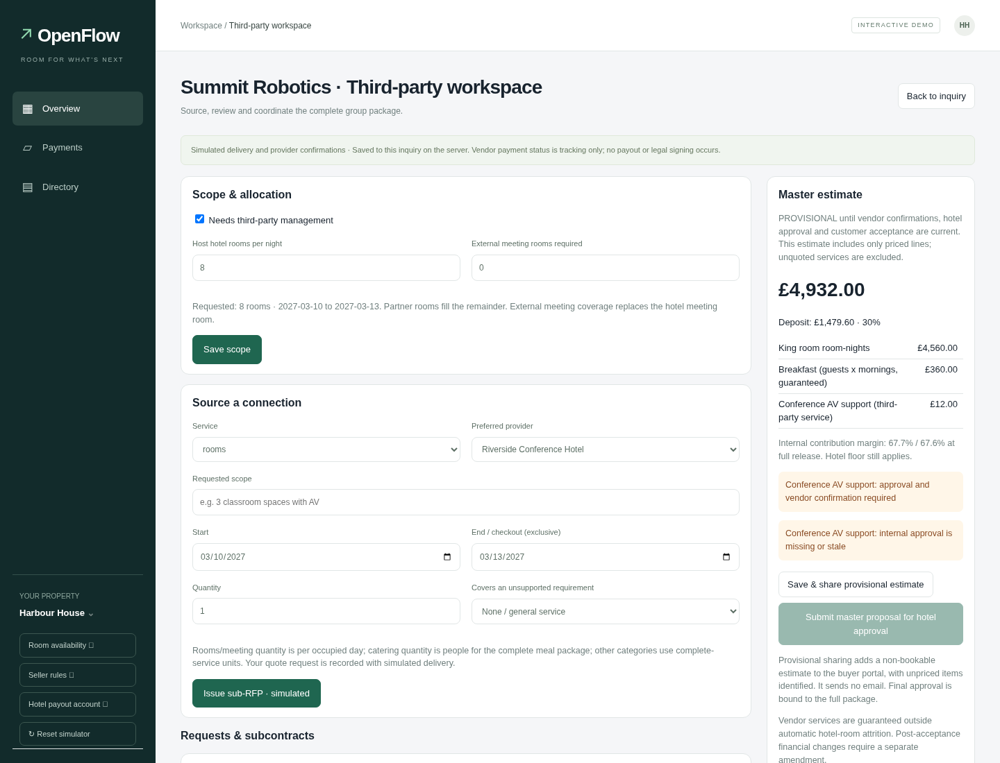
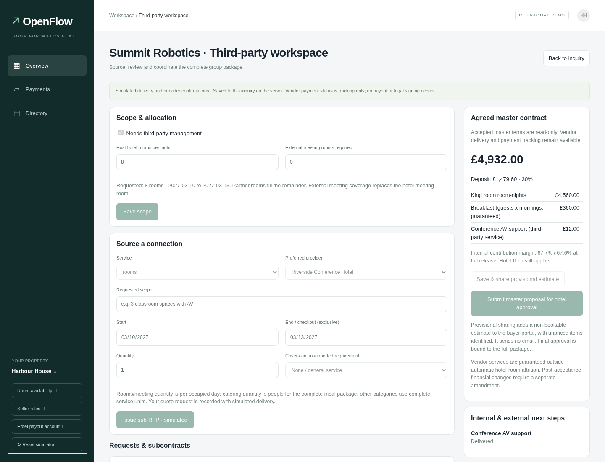

# Third-party vendor management inside an inquiry

This extends the persisted group-sales RFP model. It is not a browser-only demo:
requests, quote versions, approvals, confirmations, master drafts, delivery notes
and tracked payment status live under each inquiry's `third_party` child object
and use the existing file/Postgres storage and hotel access gate.

## How to use it

1. Open a connected Harbour inquiry and enable **Needs third-party management**.
   The dedicated third-party workspace opens. **Manage connections & subcontracts**
   returns to it later; the URL can also be reloaded directly.
2. Set the host hotel room allocation and any external meeting-room requirement.
   Partner room requests must exactly cover the remaining requested rooms for
   every occupied night. All externally supplied meeting rooms replace the
   existing single hotel meeting-room line; mixed internal/external meeting-room
   packages are not supported in this first version.
3. Issue a sub-RFP to a matching preferred provider. Supply the service description,
   dates, quantity and, where applicable, which unsupported inquiry requirement
   it covers. Rooms and meeting rooms are priced per occupied day. Catering
   quantity is people for the complete meal package; other categories use complete
   service units. No actual message is sent.
4. Record a simulated provider quote: GBP unit cost, flat GBP markup per sub-item
   or whole-percentage markup, and an expiry in UTC. A revised quote keeps its
   history but requires new internal approval and provider confirmation.
5. Revenue operations/hotel management approve the exact quote, or request revision
   with a reason. **Simulate vendor confirmation** checks the shared seeded
   provider capacity across all active inquiries. An unavailable provider can be
   recorded with a reason; its current quote/approvals are invalidated. Cancel
   that request and source an alternative, or record a revised quote later.
6. **Save & share provisional estimate** saves a non-bookable master draft and
   posts a clearly provisional itemized estimate in the buyer portal. Unpriced
   services are named and excluded from the priced subtotal. This sends no email
   and does not create an offer the buyer can accept.
7. Once every active service is priced, approved and confirmed, submit the final
   master proposal for hotel approval. Existing pricing floors, contribution-margin
   checks and inventory rules still apply. The buyer then uses the original
   acceptance and GBP deposit flow for the complete package.
8. After the booking is confirmed, mark vendor work in progress/delivered, record
   execution notes and track payments as unpaid/scheduled/paid. These are tracking
   records only; they execute no vendor transfers.

**Directory** in the left navigation contains separate searchable internal and
external lists. The four staff names and five providers are seeded fictional
contacts, using reserved `.example` addresses and example phone numbers. They are
stable across restarts so existing requests retain their provider references.
The directory is read-only in this version; edit its JSON seed through a reviewed
code change to change the network. Directory identities do not create real users,
login credentials or email delivery.

## Internal versus external next moves

The dashboard splits **Your next moves** into:

- Internal actions: existing hotel decisions, vendor quote review/revision,
  master preparation, operations handoff and tracked vendor payment tasks.
- Waiting on external providers: quotes, availability/terms confirmation and
  delivery in progress. Each opens the relevant inquiry's third-party workspace.
- Waiting on buyers: existing buyer reply/payment tasks retain visibility.

A ready vendor contract is not itself a confirmed customer booking. Vendor quote
approval, provider confirmation, hotel master approval, buyer acceptance and
verified deposit remain distinct steps.

## Pricing and fulfillment controls

The original `terms.rooms` remains **hotel-only** inventory. Partner rooms and
other services are immutable `terms.vendor_lines` snapshots in the master offer.
The main room-night KPI includes the partner portion. The provider directory has
explicit simulated capacity per category/day; confirming a second inquiry cannot
oversell already committed partner capacity. Expired quotes on unaccepted inquiries
no longer consume simulated provider capacity. Accepted commitments remain locked.

Vendor costs and markup are private. The buyer sees bundled selling prices,
service quantities, dates and fulfillment location, not supplier costs, markup,
internal approvals or contact records. An externally catered breakfast package
replaces the hotel's breakfast line and must cover all guests for every night;
it does not consume or silently expand the hotel's breakfast capacity.

Costs, selling prices, flat fees and percentage calculations use integer pence.
Flat markup is applied once per sub-item, not once per unit. Vendor selling prices
are included in the same total and deposit as the hotel charges; vendor costs
are included in both contribution-margin cases. The existing 40% margin floor
still applies, so a low-margin pass-through package can be refused. Markup must
be increased or the scope revised; enabling vendors does not waive hotel policy.

Vendor lines participate in the existing master-version hash. Any financial
vendor action before customer acceptance supersedes the master offer, stales
pending approvals and releases its hotel hold. Changes to the inquiry's dates or
requirements invalidate vendor quotes. Expired/missing/stale vendor confirmations
block final offer sending, customer acceptance and checkout; the paid-booking
commit path also verifies vendor readiness. Accepted vendor commitments are not
silently repriced when the market quote's pre-acceptance expiry later passes.

After customer acceptance, vendor financial edits/cancellation are refused.
A dedicated service-amendment/refund workflow is outside this first version.
Ordinary hotel-room attrition does not reduce the guaranteed external service
charges. The workspace shows accepted master pricing as read-only, while delivery
and payment tracking remain available. No existing hotel-only spec figure or
scenario behavior changes when third-party management is disabled.

## Agent access and simulation boundary

The seller has typed `vendor_workspace` and `request_vendor_quote` tools, recorded
in the AI Agent trace. Hotel staff must enable the workflow first. These tools
cannot approve quotes, confirm provider availability, pay suppliers or change
commercial rules. Quote approvals remain hotel-side controls, using the existing
shared hotel access model; the fictional directory is not a new identity system.

This version does **not** send real vendor emails, authenticate vendor recipients,
e-sign legal contracts, read external PMS inventory, convert vendor currencies or
execute vendor payments. It uses the existing versioned customer proposal as its
master commercial record. All provider delivery/confirmation controls are labelled
simulated. Real outreach and external capacity/signature integration are later
work, not completed integrations.

## Validation

```bash
PYTHONPATH=src .venv/bin/python -m pytest tests -q
node --check web/vendors.js
node --test tests/test_openflow_demo.cjs

# Use an isolated local server, no real database or payment credentials:
DATABASE_URL= PAYMENTS=simulated SELLER_MODE=rules GS_PORT=8018 \
  GS_VAR=/tmp/vendor-test .venv/bin/python scripts/group_sales.py
# In another terminal, with Playwright installed:
NODE_PATH=/path/to/playwright/node_modules node ui/test/vendors.cjs
```

`VENDOR_TEST_URL` selects another loopback port and `CHROMIUM_PATH` another browser.
The browser test refuses remote targets and resets only the local simulated
scenario. It verifies directory search, inquiry activation, sub-RFP/quote review,
provisional sharing, next-action lanes, manager approval, buyer privacy, the real
simulated master checkout, delivery/payment tracking, reload persistence and mobile
layout. Python tests cover 100 rooms plus 3 external meeting rooms, provider
capacity across inquiries, incomplete/stale/expired approvals, markup arithmetic,
margin enforcement, external breakfast, role and access checks, accepted-term
locking and transactional refusal.

The existing `scripts/e2e_demo.js` was attempted. It still times out waiting for
hidden legacy `#queue .q` controls on current main; that failure is not reported
as a passed check. The dedicated vendor browser test exercises the actual
workbench and original hosted checkout end to end. The FX browser regression also passes. The older `ui/test/openflow.cjs` was
attempted too; it still expects the removed “Receive an email RFP” browser-only
simulator control, whereas main now uses “Sample email RFP” backed by `/api/inbox`.
That pre-existing harness mismatch is reported as failed, not silently skipped
or repaired as part of this vendor feature.

No Render settings or deployments are changed by this PR. A person should check
this branch's combined proposal/deposit behavior on Render staging before live
promotion, as required by [AGENTS.md](../AGENTS.md). No live Airwallex behavior is
claimed from the local simulated checks.

## Screenshots





[Mobile workspace](screenshots/vendors/mobile.png).

## Provider history and hypothetical responses

Click an external provider in **Directory** (or its name on a subcontract) to see
supplier costs, quantities, service dates, inquiry references, quote revisions,
workflow status and recorded payment status. Each subcontract also has **Past
transactions with this provider**, excluding its own inquiry. Costs are GBP pence
before hotel markup. A quote is not a paid charge: `paid` is staff tracking only,
not verified evidence of a transfer. All current provider activity is simulated.
There are no invented historical invoices; history starts with recorded quotes.

History is upserted per run and subcontract, so revising a quote does not duplicate
spend. It survives scenario resets/restarts in `groupsales_vendor_history.json`
(using the normal Postgres document store when configured). Existing current and
retained archived runs are imported when history is read; previously discarded
runs cannot be recovered. Archived inquiries remain read-only history rows.

In **New inquiry**, select **Needs third-party services**, choose a category, and
optionally select **Include a hypothetical quote response**. This works for both
generated inquiries and written inquiries. Once valid stay dates are recorded,
the engine creates one preferred-provider request. Rooms replace one host room;
meeting space replaces the hotel meeting room; other services supplement the
package. Review the scope/quantity before proposing. Incomplete dates leave the
simulation pending. Duplicate emails or repeated requirement extraction do not
create duplicate subcontracts.

**Generate hypothetical quote response** is also available on existing requests.
It records a normal simulated quote revision with directional category rates,
20% markup and two-day expiry. It invalidates earlier approvals and master offers.
RevOps must approve the exact quote and simulate provider confirmation before the
normal master proposal, hotel approval, buyer acceptance and checkout can proceed.
No vendor is contacted or paid by these features. Accepted financial terms remain
locked. Buyer-visible pricing continues to hide supplier costs and markup.

Additional browser check (isolated local simulated server):

```bash
VENDOR_TEST_URL=http://127.0.0.1:8023 node ui/test/vendor-history.cjs
```
